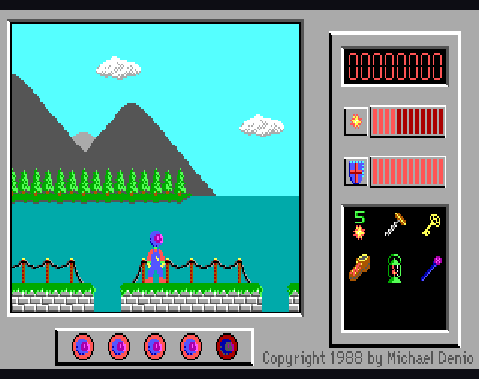
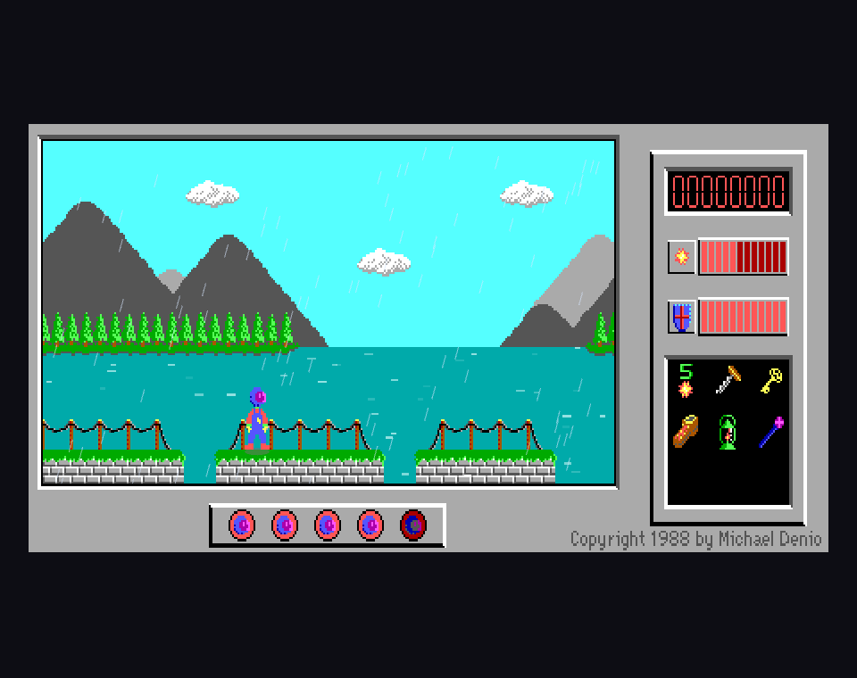
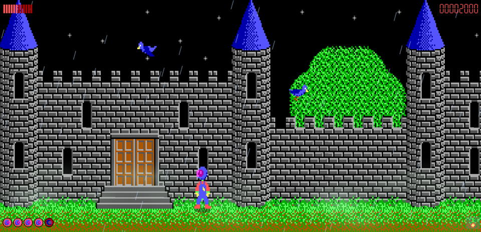
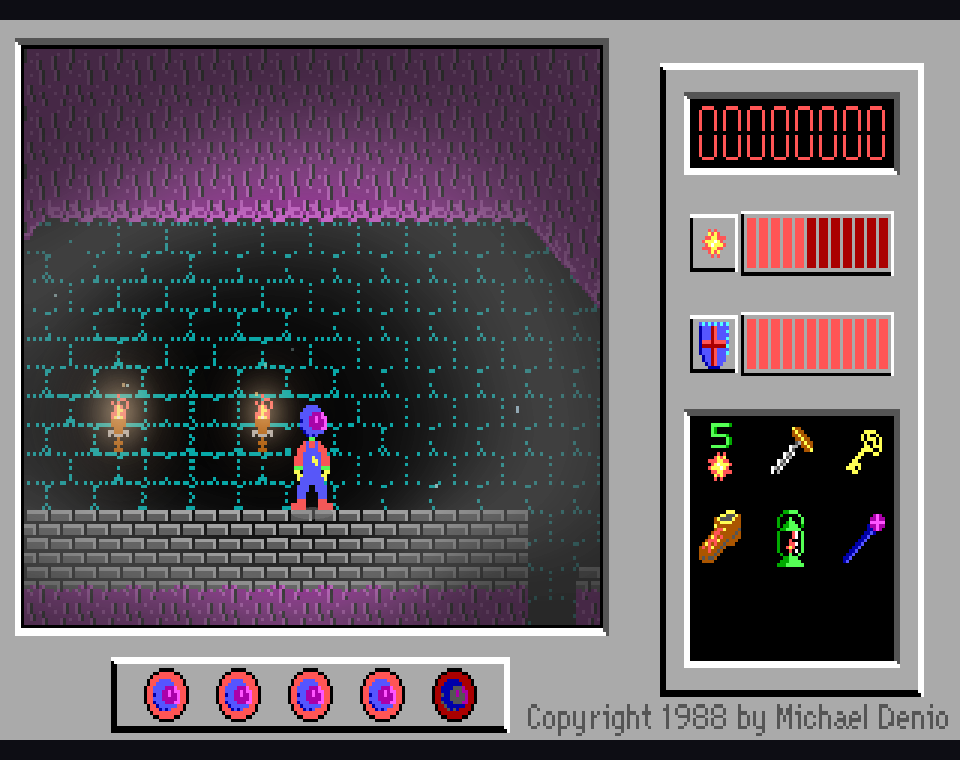
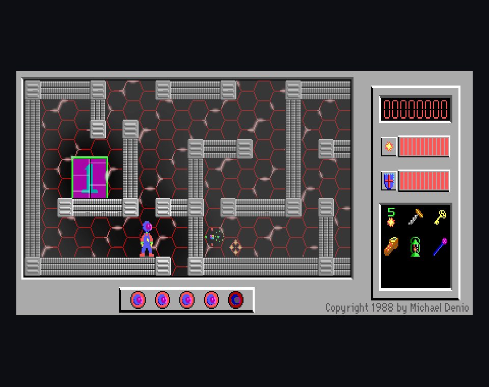
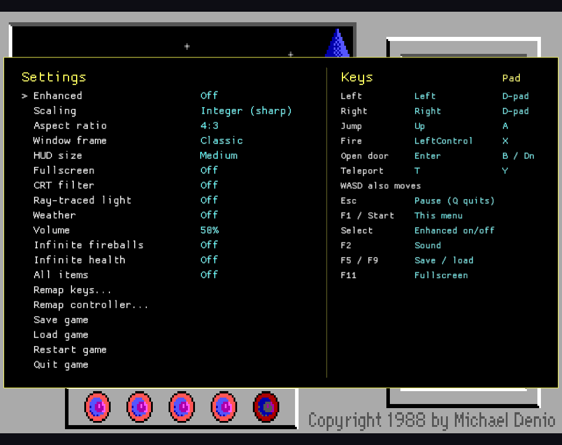

# Captain Comic Remastered

A native Windows port of the 1988 DOS game *The Adventures of Captain Comic* (by Michael Denio), written in Rust with
[macroquad](https://macroquad.rs). The game logic was reverse engineered from the original program and is checked
against it with differential tests (see `NOTES.md`). By default it plays like the original; every enhancement is
optional.

## Screenshots 

| | |
|---|---|
|  |  |
| The default: exactly the original's look, pixels 1.2x tall as on a DOS monitor. | Enhanced: 16:9, smooth 60 fps motion, effects and optional rain. |
|  |  |
| The Immersive window: no frame, the world fills the screen and the HUD sits over it. | Ray-traced light in the cave. |
|  |  |
| Data pulses along the circuit lines in the computer level. | The F1 settings menu, with keyboard and controller bindings. |

**The original game is included**, unchanged, as `game/Adventures of Captain Comic, The (1988).zip`. Its author,
Michael Denio, released it as shareware with these terms (from the `comic.doc` inside the zip): it "may be
re-distributed" provided that 1. "the program and graphics (including world maps) may not be distributed in any
modified form" and 2. "no form of compensation is [to be] collected from the distribution of this program". So that
file must stay exactly as it is and this project must stay free. The game remains the property of its author; the MIT
licence below covers only the code of this port.

Keep the zip (or the unpacked folder that contains `comic.exe`) in a folder named `game` next to the executable, or
point the program at a folder or `.zip` on the command line. A zip is unpacked once next to itself.

## Build and run

```
cd captain-comic
cargo build --release
```

The result is a single executable (`captain-comic/target/release/captain-comic.exe`, static runtime). On Windows,
`play.bat` builds it, copies it to `CaptainComicRemastered.exe` in the project folder and starts it. Settings, the save file,
key bindings and high scores are written next to the executable.

## Playing

Default keys are the original's: arrows move, Space jumps, Insert fires, Alt opens doors, Caps Lock teleports.
A gamepad works too (d-pad or stick to move, A jump, X fire, B or d-pad down open a door, Y teleport).

**F1** (or Start on a pad) opens the settings menu:

- **Enhanced** turns on smooth 60 fps motion, visual effects (particles, glow, ambient details in each level),
  controller rumble and a hint at locked doors. Select on a pad toggles it.
- Aspect ratio (4:3 or 16:9), an **Immersive** mode without the window frame, HUD size, fullscreen, scaling, an
  optional CRT filter, rain, audio volume.
- **Ray-traced light**: the castle (after you find the Lantern), the cave, the base, the shed and the computer level get
  soft shadows from torches, glowing tiles, fireballs and Comic's own light.
- Save and load game (also F5 / F9), key and controller remapping, cheats (infinite fireballs, infinite health, all
  items), restart, quit.

Everything is off by default, so the faithful original behaviour is what you get until you change something.

## Notes

`NOTES.md` documents how the original works (map and collision rules, enemy behaviours, sound, level data) and how
the port is organised. `cargo test --release` runs the unit tests; the tests that compare against the original
program are skipped when the original files are not found at `../AdvCapCo`.

## Licence

The code in this repository is released under the [MIT licence](LICENSE). That covers only this port. *The
Adventures of Captain Comic* itself, its graphics and its sound remain the property of their owner and are
redistributed under the terms quoted above.
